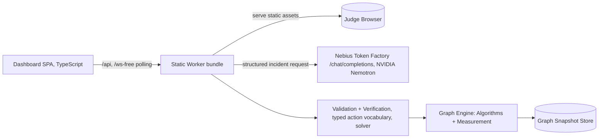

# BUILD_PLAN — AETHER-NIM

An Autonomous Spectral Network Resilience and Self-Healing Digital Twin.

Status: ACTIVE — build started 2026-10-29 ~18:00 UTC; deadline 2026-10-30 17:00 UTC.

## Environment (verified)
- Windows host, Git Bash: Node 22.17 / npm 11.18 / git 2.55. **No Python.**
- Vercel + Cloudflare Workers deploy targets available (static assets + serverless or edge ISOs).
- No Nebius credentials in env yet → honest-fallback design until key supplied.

## Architecture

- `web/` React+Vite+Cytoscape dashboard; dark engineering theme.
- `server/` from Hono (runs locally via @hono/node-server, deploys to Worker via esbuild bundle) exporting `/api/*` JSON — a single source of truth for the API logic shared across local run and deploy.
- `engine/` The deterministic sport plane: **Graph Engine** (algos) + **Validation + Verification** (typed action vocabulary, solver). Pure TS, zero IO — unit-testable.
- `benchmarks/` runs scenarios → JSON.

## Sequence
**DONE**
**P0 in flight:** scaffold, worker skeleton, scenario pack (three seeded scenarios), run `_local` health.
**P1 next:** engine (union-find connectivity, Laplacian/Jacobi algebraic connectivity λ2, Brandes betweenness, cut edge detection, capacity feasible routing via SSP min-cost flow); typed action vocabulary {RestoreEdge, RestoreNode, OpenCandidate, Retune, Reroute}; verifier + rollback; greedy optimizer with lexicographic minimizing objective.
**P2:** Nebius client (structured incident JSON → thin analysis message; correctness owned by deterministic engine), honest "verify" vs "AI" separation.
**P3:** frontend demo scenario, gemini-grade trace mining, deploy a public preview.
**P4:** benchmarks (12 cases × deterministic seeds × baseline vs self-healing), deploy via Vercel, real screenshot.
**P5:** video script (YouTube must be <3min), Devpost draft, submit if possible.

## Open risks
- **Nebius key missing →** must ask user; worker degrades to `fallback` mode, UI shows plainly "fallback mode" — never fake model output.
- **Topo/public assets** must all be self-contained; no CDN fonts/libs.
