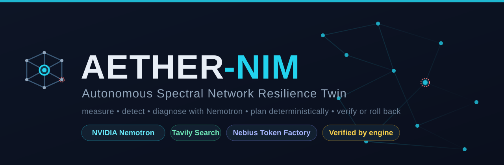
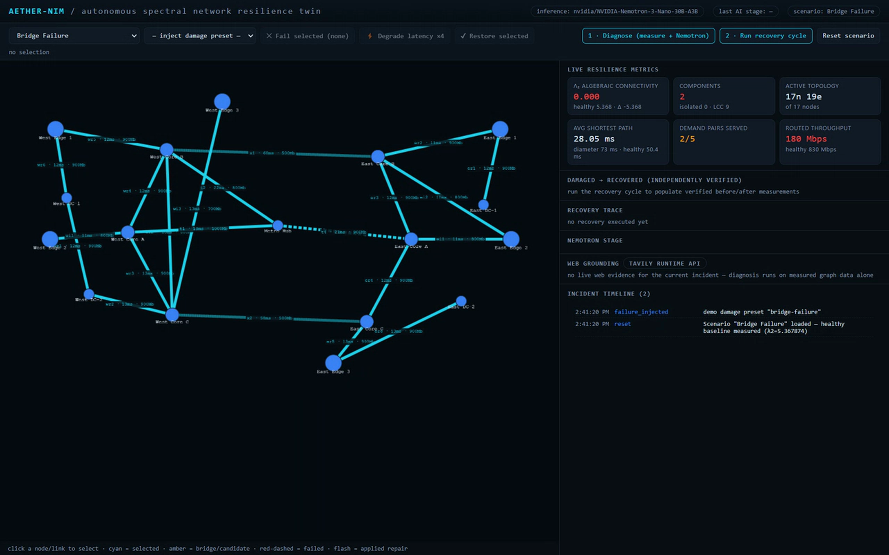
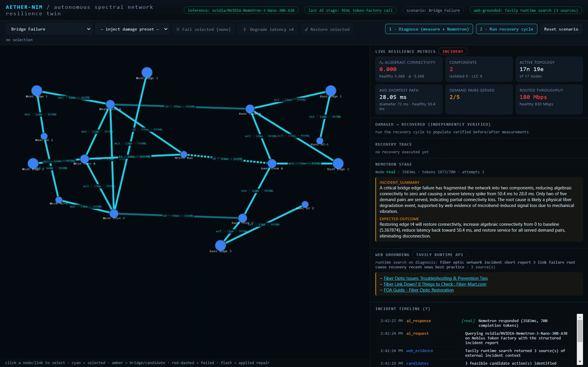
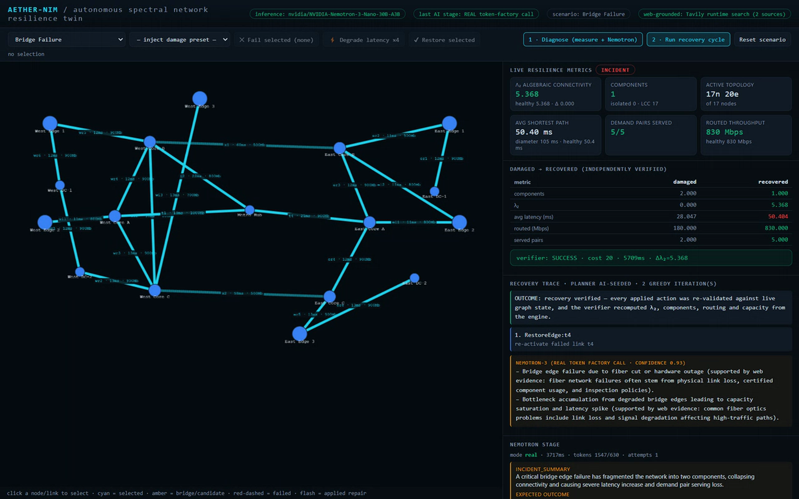
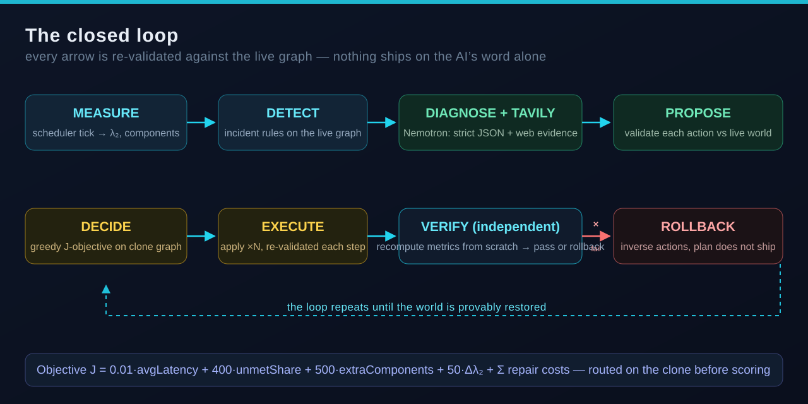

<div align="center">



[](#quick-start)
[](#benchmarks)
[](#artificial-intelligence--web-grounding)
[](#web-grounded-diagnosis-tavily--nemotron)
[](LICENSE)
[]()

**A network digital twin that breaks like production, diagnoses with real AI, and refuses to ship any repair it cannot prove.**

[🌐 Live demo](https://aether-nim-vsadhithyan505-5634s-projects.vercel.app) &nbsp;·&nbsp; [▶ 1:36 cinematic demo](https://youtu.be/hqNuCS9_6tc) &nbsp;·&nbsp; [Nebius × NVIDIA Global AI Hackathon](https://nebiusglobalaihackathon.devpost.com/)

</div>

---

Every incident page says *"what broke."* None of them say **"do this, and prove it worked."** AETHER-NIM closes that gap on a graph: it fails a real network on demand, measures the damage in spectral terms, asks **NVIDIA Nemotron-3 (Nebius Token Factory, web-grounded by a live Tavily Search API call)** what to do, checks every proposed action against the live world, plans with a **deterministic graph optimizer**, and only then lets an **independent verifier** stamp *recovery confirmed* — or rolls the whole plan back.

At a glance — one closed loop, four real panels from the live deployment:

| Healthy — λ₂ = 5.368, one component | Incident — injected bridge failure, λ₂ → 0.000 |
|:---:|:---:|
|  |  |
| **Diagnose — Nemotron + live Tavily citations on screen** | **Verify — independent verifier: SUCCESS, λ₂ restored, 5/5 demand pairs** |
|  |  |

*(Every number above is computed by the engine from the graph — nothing is mocked and nothing is claimed by the AI itself.)*

---

## The trust pipeline



The design principle is simple: **AI proposes, the engine disposes.** The model is never allowed to mutate state, exceed the action vocabulary, or override a measurement — each of its proposals must survive the same rules a human operator's would.

| Stage | What runs | Guard |
|---|---|---|
| **Measure** | scheduler tick → `computeMetrics()` on the live graph | ✎ engine-only |
| **Detect** | `detectIncident()` — component count / λ₂-gap rules | ✎ engine-only |
| **Diagnose** | Nemotron-on-Nebius: structured report **in / strict JSON out** + `web_evidence` from a **runtime Tavily Search call** | plugin — removable, degrades to measured-data-only |
| **Propose** | every AI action re-validated against the *live* world (id exists, is actually faulted, stays in vocabulary) | crossed out if it lies |
| **Decide** | `planRecovery()` greedy lookahead minimizing **J** on a clone graph | deterministic |
| **Execute** | `applyAction()` ×N, each step re-validated | deterministic |
| **Verify / Rollback** | `verifyRecovery()` recomputes metrics **from scratch**; pass → commit, fail → inverse actions applied | independent module, thresholds are the contract |

## Why this is the hard part

Most "AI agent fixes it" demos die in one of two ways: the model **hallucinates valid-sounding actions** (`RestoreEdge:t42` where `t42` never existed), or the demo **asserts** recovery instead of measuring it. AETHER-NIM hardens against both, by construction:

- **Closed action vocabulary** — `RestoreEdge / RestoreNode / OpenCandidate / Retune`; a plan can never exceed it, never bypass `minLatencyMs`, never act on a healthy component.
- **Feasible-by-construction candidates** — `generateCandidates()` reads only the live graph.
- **Clone-graph scoring** — every candidate plan is evaluated on a copy, never on the wounded twin.
- **Independent verifier** — a separate module owns the pass/fail gates; the planner cannot grade its own homework. Timing races are impossible: execution re-validates each action against the live world before applying it.

## Artificial intelligence + web grounding <br/> <sub>`web-grounded diagnosis (Tavily + Nemotron)`</sub>

At diagnosis time the twin makes a **runtime call to the Tavily Search API** — real, current-surface-web context on fiber-cut incidents and restoration practice — and hands it to **NVIDIA-Nemotron-3-Nano-30B-A3B** on Nebius next to the measured graph as `web_evidence`. The model may cite those source titles inside its root-cause hypotheses; you watch the citations land in the UI in real time. What evidence may **not** do: rewrite metrics, invent link IDs, or overrule the planner. Any plan that fails the gate is discarded end-to-end and the twin rolls back, visibly, in the UI.

**Trust boundary:** the Nebius + Tavily credentials stay server-side behind two stateless proxies (`/api/ai`, `/api/web`); the dashboard ships the twin, never a key.

## Benchmarks

9 damage scenarios × 3 strategies (`benchmarks/run.ts`, machine-generated artifacts in `benchmarks/results/`):

| Strategy | Plans verified | Restored service (avg) | Plan time (avg) | Actions |
|---|:---:|:---:|:---:|:---:|
| **`objJ-plan` (ours — AI-advised, engine-verified)** | **9/9** | **100%** | **6 ms** | 2.7 |
| `greedy-no-lookahead (baseline)` | 9/9 | 100% | 7 ms | 2.3 |
| `restore-all-failed (baseline)` | **6/9** | 92% | — | 2.0 |

Baseline service at injection time is **18.5%** across the suite — the network is *actually broken* in every case before the planner sees it. `objJ-plan` never ships an unverified plan; the naive "just restore everything" baseline ships three plans that fail verification.

## Quick start

```bash
cp .env.example .env       # add your Nebius key (runs fine without one too)
                           # optional: TAVILY_API_KEY enables web-grounded diagnosis
npm install
npm run dev                # API on :8787 + Web on :5173
npm test                   # 23 vitest suites (unit + integration + resilience + web-grounding)
npm run bench              # 18-case benchmark vs scripted baselines
```

Open a local twin, click **damage**, watch λ₂ collapse, hit **diagnose** to see Nemotron's ranked plan with live Tavily citations, then **recover** and watch the independent verifier stamp it.

## Repository layout

```
engine/      closed-vocabulary recovery engine (graph, metrics, damage presets, AI adapter)
server/      Hono API server (app.ts), local Node entry, Vercel serverless entry + bundled build
web/         React + Cytoscape canvas dashboard — embeds the engine, so the public demo needs zero server state
benchmarks/  18-case runner with baselines → JSON artifacts in benchmarks/results/
scripts/     ai-integration-check.ts — end-to-end real-AI proof runner
worker/      alternate edge-Workers entry with durable twin state
media/       demo recordings, narration scripts, and the cinematic cut (media/hd/final_hd.mp4)
docs/        brand assets & screenshots used by this README
```

## License

MIT — see [LICENSE](LICENSE).

<div align="center">

*AETHER-NIM — trust, but verify, **as software**.*

</div>
